<a href="https://hoang-folio.pages.dev">hoang-folio.pages.dev</a> &nbsp;·&nbsp; <a href="https://hoang-dev-portfolio.netlify.app">3D Portfolio</a> &nbsp;·&nbsp; <a href="https://x.com/leontran_o">@leontran_o</a> &nbsp;·&nbsp; <a href="mailto:tranhuyhoangstu@gmail.com">tranhuyhoangstu@gmail.com</a>

Open to Full-Stack, Backend (.NET / NestJS), and Applied AI roles — Ho Chi Minh City or remote

